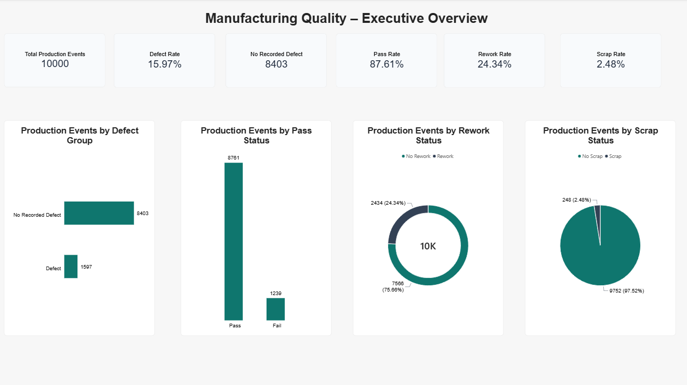
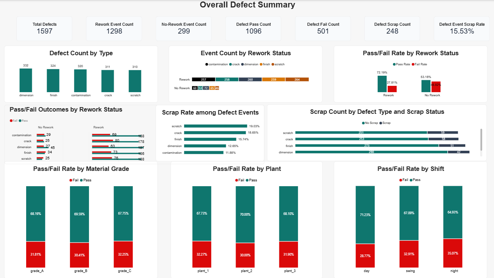
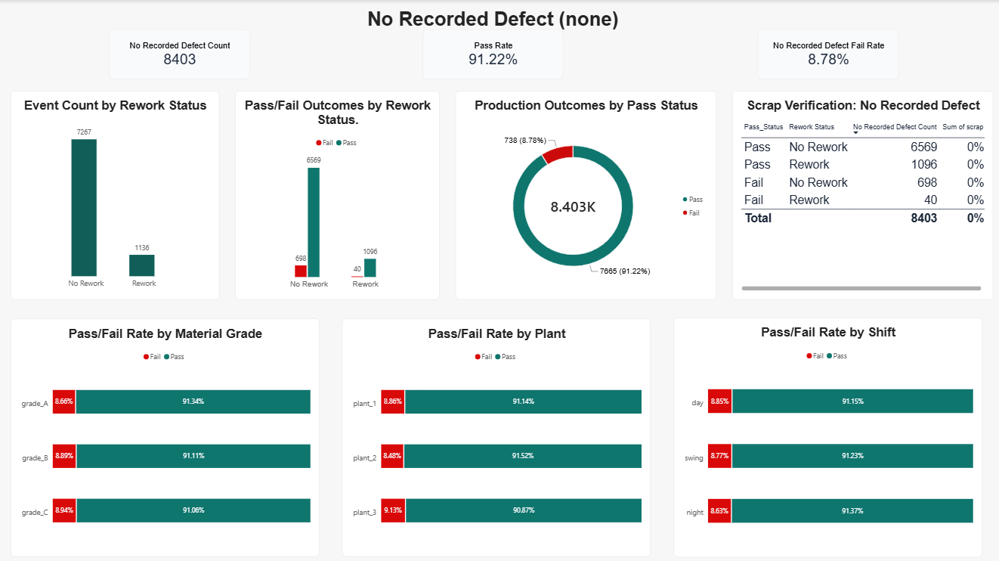

# Manufacturing Quality Analysis

## Project Overview
This project analyzes manufacturing production quality performance using Excel and Power BI. The objective is to identify defect patterns, evaluate rework outcomes, examine scrap rates, and highlight areas that require quality improvement.

The analysis covers 10,000 production events across different material grades, plants, production lines, and shifts.

## Tools & Technologies
- Microsoft Excel – Data preparation and exploratory analysis
- Power BI – Data visualization and interactive dashboard
- DAX – KPI and performance metric calculations

## Key Business Questions
1. Which defect types occur most frequently?
2. Which defect types have the highest scrap rates?
3. How do production outcomes differ between reworked and non-reworked events?
4. Which material grades, plants, and shifts show higher failure rates?
5. Which production segments require further investigation?

## Dashboard Pages

### 1. Executive Overview
Provides a high-level summary of manufacturing quality performance.

### 2. Defect Analysis
Examines defect frequency, pass/fail outcomes, rework performance, and scrap rates across defect categories.

### 3. No Recorded Defect Analysis
Examines production events where no defect was recorded, including pass/fail outcomes and rework patterns.

## Key Findings

### 1. Defect Frequency vs. Scrap Severity
- Dimension recorded the highest number of defect events (332).
- Scratch recorded the highest scrap rate (19.03%), followed by Crack (18.65%).
- The most frequent defect type does not necessarily have the highest scrap rate.

### 2. Rework Performance
- Reworked defect events achieved a pass rate of 72.19%.
- Non-reworked defect events achieved a pass rate of 53.18%.
- This represents a difference of 19.01 percentage points.

The results show an association between rework and better pass outcomes, although they do not establish causation.

### 3. Defect-Related Production Quality Patterns

Among production events with recorded defects:
- Grade C recorded the highest failure rate among material grades at 32.25%.
- Plant 1 recorded the highest failure rate among plants at 32.27%.
- Night Shift recorded the highest failure rate among shifts at 35.07%.

These findings indicate differences in failure performance across material grades, plants, and shifts within the recorded defect group.

### 4. Quality Concerns in Events with No Recorded Defects

Among the 8,403 production events with no recorded defects:
- 1,136 events (13.52%) underwent rework despite having no recorded defect.
- 40 reworked events failed the final inspection.
- Another 698 events failed without undergoing rework.
- No scrap events were recorded in this group.

**Business Implication:**

The presence of rework and failed production outcomes among events with no recorded defects raises questions about defect identification, recording practices, and inspection processes. Management should investigate why rework was performed when no defect was recorded and verify whether quality issues were properly documented.

### 5. Detailed Investigation
Further analysis of Grade C at Plant 1 during Night Shift revealed:
- Failure rate: 56.67% (17 out of 30 defect events).
- Contamination contributed the highest scrap count (3 events).
- Finish recorded the highest scrap rate (50%, based on 2 out of 4 events).

The small sample size should be considered when interpreting these results.

## Business Recommendations

1. **Investigate Contamination Issues:** Review machine cleanliness, material handling, and inspection procedures, particularly in production segments with higher contamination-related scrap.

2. **Evaluate Rework Effectiveness:** Review rework procedures and post-rework inspection practices to identify factors contributing to failed outcomes despite rework.

3. **Investigate Quality Issues in Events with No Recorded Defects:** Examine why 1,136 events underwent rework despite having no recorded defects, including the 40 events that failed after rework. Investigate the 698 failed events without rework to determine whether defects were missed, undocumented, or related to other process issues. Strengthen defect recording and inspection procedures to improve quality traceability.

4. **Strengthen Scrap Prevention and Monitoring:** Monitor scrap rates and defect frequency across material grades, plants, production lines, and shifts. Prioritise high-risk defect types while considering event counts and sample sizes.

## Data Limitation
The `No Recorded Defect` category represents production events where no defect was recorded in the dataset. It does not necessarily confirm that no underlying quality issue existed.

## Project Files
- Excel dataset: `Dataset/Manufacturing_Quality_Performance_Analysis.xlsx`
- Power BI dashboard: `PowerBI/Manufacturing_Quality_Analysis.pbix`
- Dashboard screenshots: `Screenshots/`

## Conclusion
This analysis highlights the importance of evaluating both defect frequency and severity when improving manufacturing quality. The findings can help management prioritise quality investigations, review rework practices, and strengthen scrap prevention efforts.
